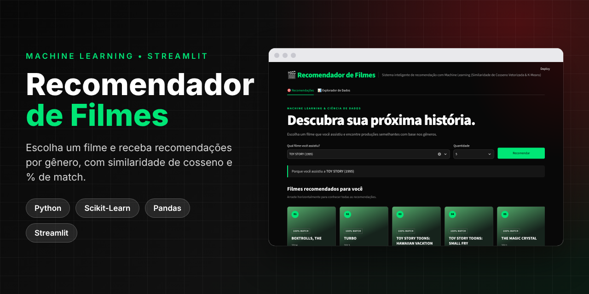
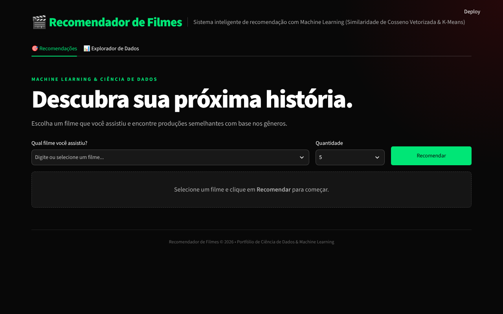
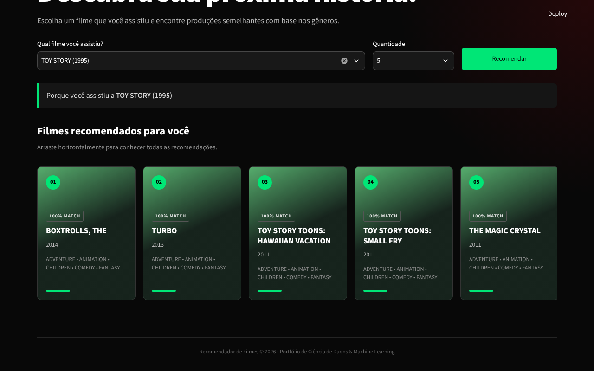
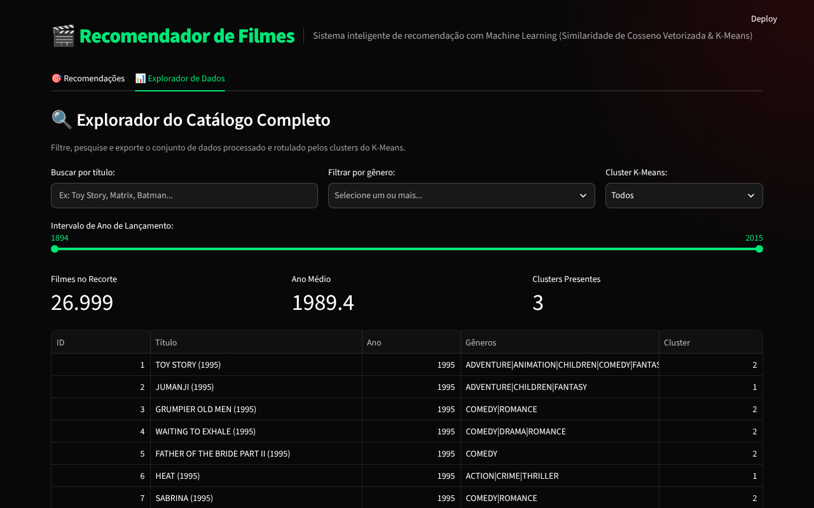
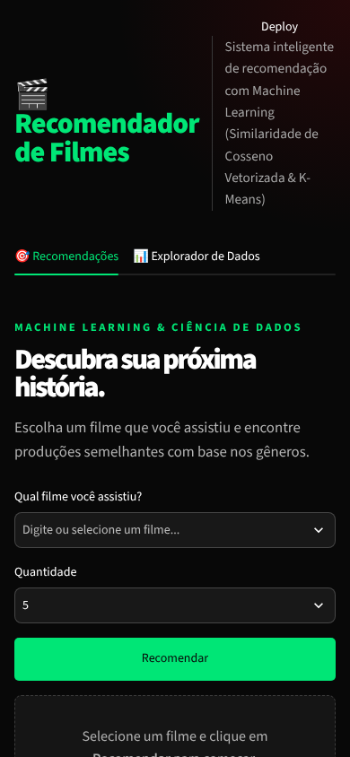

<p align="center">
  
</p>

<h1 align="center">🎬 Recomendador de Filmes — Content-Based</h1>

<p align="center">
  Aplicação em <b>Streamlit</b> que recomenda filmes parecidos com o que você assistiu, a partir dos
  <b>gêneros</b>: ranking por <b>similaridade de cosseno</b> vetorizada, com percentual de afinidade
  (<b>Match %</b>) em cada recomendação e agrupamento com <b>K-Means</b>, sobre o catálogo do <b>MovieLens</b>.
</p>

<p align="center">
  
  
  
  
  
</p>

<p align="center">
  <a href="#-sobre-o-projeto">Sobre</a> •
  <a href="#-funcionalidades">Funcionalidades</a> •
  <a href="#️-telas">Telas</a> •
  <a href="#-como-funciona">Como funciona</a> •
  <a href="#-como-executar">Como executar</a> •
  <a href="#-testes-automatizados">Testes</a> •
  <a href="#-estrutura-do-projeto">Estrutura</a>
</p>

---

## 📌 Sobre o projeto

O usuário escolhe um filme que já assistiu e recebe de 5 a 10 recomendações ordenadas pela afinidade de gêneros,
cada uma com o seu percentual de *match*. Uma segunda aba funciona como explorador do catálogo processado: busca, filtros, métricas e exportação
em CSV.

O projeto nasceu no workshop de sistemas de recomendação da **Info Dados** (@info_dados), cujos cadernos de aula
estão em [`estudos/`](estudos). A partir deles, o código foi reorganizado em um pipeline separado da interface
([`src/recommender.py`](src/recommender.py)), com similaridade de cosseno vetorizada, métrica de avaliação, testes
automatizados e uma interface própria.

## ✨ Funcionalidades

| | Recurso | Descrição |
|---|---|---|
| 🎯 | **Recomendações** | Escolha um filme e a quantidade (5 a 10); os resultados aparecem em cards com ano, gêneros e **% de match** |
| 📐 | **Similaridade de cosseno** | Calculada entre o filme e todo o catálogo numa única operação matricial, com desempate pelo ano mais recente |
| 🧩 | **K-Means** | Os filmes são agrupados em 3 clusters pelos gêneros; a busca pode, opcionalmente, ficar restrita ao cluster |
| 📏 | **Métrica de precisão** | `evaluate_genre_precision` mede quanto dos gêneros recomendados pertence aos gêneros do filme escolhido |
| 🔍 | **Explorador de dados** | Busca por título, filtro por vários gêneros, cluster e intervalo de anos |
| 📊 | **Métricas** | Total de filmes no recorte, ano médio e clusters presentes |
| 📥 | **Exportação** | Baixa o recorte filtrado em CSV |
| ✅ | **Testes** | 6 testes com `pytest` cobrindo limpeza, treino, recomendação, métrica e filtros |

## 🖼️ Telas

<table>
  <tr>
    <td align="center"><b>Início</b><br></td>
    <td align="center"><b>Recomendações</b><br></td>
  </tr>
  <tr>
    <td align="center"><b>Explorador de dados</b><br></td>
    <td align="center"><b>Celular</b><br></td>
  </tr>
</table>

## 🧠 Como funciona

1. **Limpeza** ([`clean_movies_data`](src/recommender.py)): padroniza o texto em maiúsculas, remove títulos
   duplicados, extrai o ano do título com regex (`"TOY STORY (1995)"` → `1995`) e descarta filmes sem gênero ou
   sem ano. Dos 27.278 filmes do `movie.csv`, ficam 26.999.
2. **Variáveis**: os gêneros (`ADVENTURE|ANIMATION|...`) viram 19 colunas binárias (*one-hot encoding*).
3. **Agrupamento**: um **K-Means** com 3 clusters (`random_state=123`) rotula cada filme. Os clusters aparecem
   no explorador e podem restringir a busca (`same_cluster_only=True`).
4. **Recomendação** ([`get_recommendations`](src/recommender.py)): calcula a **similaridade de cosseno** entre o
   filme escolhido e todos os outros do catálogo em uma única chamada vetorizada. A coluna `SIMILARIDADE` vai de
   **0 a 1** (1 = mesmos gêneros) e vira o percentual de *match* dos cards. Empates são decididos pelo ano mais
   recente. A distância euclidiana continua disponível com `metric="euclidean"`.
5. **Avaliação** ([`evaluate_genre_precision`](src/recommender.py)): média, entre as recomendações, da fração de
   gêneros de cada uma que também pertence ao filme escolhido. Para *Toy Story* e *Matrix*, as 5 primeiras
   recomendações têm similaridade 1,0 e precisão 1,0.

O resultado do treino (base rotulada, lista de gêneros e modelo) fica salvo em `modelo.pkl`, que a aplicação
carrega ao abrir.

## 🚀 Como executar

**Pré-requisito:** Python 3.11 ou superior.

```bash
git clone https://github.com/kauaxp77/Workshop.git
cd Workshop

python -m venv .venv
# Windows (PowerShell)
.venv\Scripts\Activate.ps1
# Linux/macOS
source .venv/bin/activate

pip install -r requirements.txt
streamlit run app.py
```

A aplicação abre em `http://localhost:8501`. O tema escuro vem de [`.streamlit/config.toml`](.streamlit/config.toml).

Para reprocessar a base e gerar o `modelo.pkl` de novo:

```bash
python src/recommender.py
```

Esses comandos foram testados com Python 3.13, Streamlit 1.67, Pandas 3.1 e Scikit-Learn 1.9. O retreino gera um
modelo idêntico ao que está versionado.

## ✅ Testes automatizados

```bash
pytest -v
```

São **6 testes** em [`tests/test_recommender.py`](tests/test_recommender.py), com uma base de exemplo própria:

- **Limpeza:** extração do ano, padronização em maiúsculas e remoção de filmes sem gênero ou sem ano.
- **Treino:** estrutura do pacote do modelo (`BASE_DADOS`, `VARIAVEIS`, `MODELO`) e rótulo de cluster em cada filme.
- **Recomendação por cosseno:** valores entre 0 e 1 em ordem decrescente, filme escolhido fora da lista e desempate
  pelo ano.
- **Restrição por cluster:** busca no catálogo inteiro (padrão) ou só no cluster do filme.
- **Métrica de precisão:** cálculo de `evaluate_genre_precision`.
- **Filtros:** busca por título, gênero, intervalo de anos e cluster.

## 📁 Estrutura do projeto

```
Workshop/
├── app.py                    # Interface em Streamlit (abas Recomendações e Explorador)
├── src/
│   └── recommender.py        # Limpeza, treino, similaridade de cosseno, métrica e filtros
├── tests/
│   └── test_recommender.py   # Testes com pytest
├── .streamlit/
│   └── config.toml           # Tema escuro da interface
├── estudos/                  # Cadernos e materiais do workshop da Info Dados
├── docs/
│   ├── banner.png
│   └── screenshots/          # Prints usados neste README
├── movie.csv                 # Catálogo do MovieLens (movieId, title, genres)
├── modelo.pkl                # Modelo treinado + base rotulada (carregado pelo app)
├── requirements.txt
└── pytest.ini
```

## 🛠️ Tecnologias

- **Python**: linguagem principal
- **Pandas**: limpeza e *one-hot encoding* dos gêneros
- **Scikit-Learn**: K-Means e similaridade de cosseno (e distância euclidiana opcional)
- **NumPy**: cálculo da métrica de precisão
- **Joblib**: salvamento e carga do modelo
- **Streamlit**: interface web
- **pytest**: testes automatizados

## 👨‍💻 Autor

Desenvolvido por **[kauaxp77](https://github.com/kauaxp77)** a partir do workshop de sistemas de recomendação da
**Info Dados**. Dados: **MovieLens** (GroupLens Research).

<p align="center">⭐ Se curtiu o projeto, deixe uma estrela!</p>
